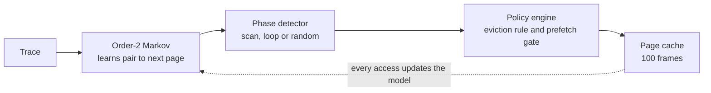

# AMPP: Adaptive Markov Page Prefetcher

A page-replacement simulator that decides **when to fetch a page early**, not only which page to evict. It combines three ideas the literature usually keeps apart:

1. an **order-2 Markov model** that learns which page follows each pair of pages,
2. a **phase detector** that labels the live reference stream as a scan, a loop, or random access,
3. a **policy engine** that switches the eviction rule per phase and turns prefetching off when it would only waste frames.

It is benchmarked against LRU, CLOCK and the full Megiddo and Modha ARC on identical traces.

Operating Systems, Project Review 1. Aryansh, Sreevatsa, Maheep.

**Live page:** https://wyattstanson.github.io/adaptive-markov-prefetcher/ runs the policies in a 3D view of the cache. Click Compare with LRU to watch LRU fail on the same trace.

## Results

100-frame cache, 20,000 accesses per trace, seed 1234, the same trace for every policy. Produced by `python -m ampp`.

| Workload | LRU hit rate | AMPP hit rate | Fewer demand faults than LRU |
| --- | ---: | ---: | ---: |
| Looping (120-page loop) | 0.0% | 99.4% | **99.4%** |
| Sequential scan (500 pages) | 0.0% | 97.5% | **97.5%** |
| Mixed (scan, loop and random segments) | 6.3% | 82.5% | **81.3%** |
| Random (uniform over 300 pages) | 33.1% | 33.1% | **0.0%** |

CLOCK and ARC land within 0.2 points of LRU on every row. Scans and loops defeat any policy that only reacts to the past, however clever its eviction choice.

### What the numbers do and do not say

A demand fault is the expensive event: the process stalls until the page arrives. AMPP avoids stalls by loading the page before it is referenced, so prefetches are reported separately and nothing is hidden.

| Workload | LRU page loads | AMPP demand faults | AMPP prefetches | AMPP total loads | Prefetch accuracy |
| --- | ---: | ---: | ---: | ---: | ---: |
| Looping | 20,000 | 120 | 3,360 | 3,480 | 100.0% |
| Sequential | 20,000 | 502 | 19,499 | 20,001 | 99.99% |
| Mixed | 18,747 | 3,496 | 11,368 | 14,864 | 99.5% |
| Random | 13,370 | 13,370 | 0 | 13,370 | not issued |

- **Loops:** total loads fall from 20,000 to 3,480. MRU keeps 100 of the 120 loop pages resident, so only the 20 that do not fit are fetched each pass, and each one arrives just before it is needed.
- **Scans:** total loads stay at about 20,000, because every page of a 500-page scan has to come in once per pass. The gain is that 97.5% of them arrive ahead of demand. Turning that into wall-clock time needs a latency model, which this simulator does not include.
- **Random:** no structure, no prediction, no prefetch. AMPP behaves exactly like LRU and claims nothing.

## How it works



Each stage is a separate module behind its own interface. AMPP is `O(1)` amortised per access.

| Phase | How it is detected | Evict | Prefetch |
| --- | --- | --- | --- |
| Sequential | at least 70% of recent steps are +1, footprint keeps growing | FIFO | up to 4 pages ahead |
| Looping | at least 40% +1 steps and the recent footprint is at most 1.5x the cache | MRU | up to 2 pages ahead |
| Random | neither | LRU | off |

The detector reads two windows: the last 32 accesses for the stride signal, and the last 400 for the footprint. A loop read in order looks exactly like a scan up close. Only the small footprint tells them apart, so looping is checked first.

A prefetch is issued only when the phase allows it **and** the model's top successor carries at least half the probability mass. Learned noise therefore never evicts a useful page.

**Why order-2.** Take the sequences `A B D` and `C B E`. A first-order model conditions on `B` alone and can predict only one of `D` or `E`. Conditioning on the pair keeps `(A, B)` and `(C, B)` apart.

**Why MRU on loops.** In a loop slightly larger than the cache, the page just used is the one needed furthest in the future. Evicting it is what Belady's optimal policy would do, and it is exactly what LRU refuses to do.

## Run it

Python 3.11 or newer. The package uses the standard library only.

From the repository root:

```bash
cd python && python -m ampp
```

```bash
cd python && python -m ampp --json ../results/report.json
```

```bash
python -m pytest tests -q
```

The suite has 24 tests. They cover:
- each baseline's correctness and its loop pathology,
- order-2 disambiguation,
- phase classification,
- the incremental footprint counter,
- end-to-end checks that fail if the scan or loop gains disappear, or if AMPP ever claims a gain on random access.

The C core reimplements the traces, LRU, CLOCK and AMPP:

```bash
cd c && make run
```

On Windows, build it inside WSL (any Linux gcc works). It compiles clean with `-Wall -Wextra` under gcc 15.2. It reproduces the Python fault counts exactly on scan and loop (502 and 120). On random and mixed it lands within a few tenths of a point, because its random generator is a different LCG from Python's.

## Project layout

```
adaptive-markov-prefetcher/
  python/ampp/
    trace.py          seeded workload generators
    markov.py         order-2 Markov predictor
    phase.py          phase detector
    engine.py         phase to (eviction rule, prefetch decision)
    benchmark.py      harness: same trace, cache size and seed for every policy
    policies/         LRU, CLOCK, ARC, AdaptiveMarkovPrefetcher
  c/                  ampp.c and Makefile
  tests/              pytest suite
  results/            report.json written by the harness
  dashboard/          the live 3D results page, deployed to GitHub Pages
  .github/workflows/  CI: tests, benchmark and C build, then the Pages deploy
```

## Limitations

- **The traces are synthetic.** Each one isolates a single textbook pathology. Real application traces are the next step.
- **Memory pressure is approximated.** It is inferred from the phase and the model's confidence, not read from a real RSS or PSI signal.
- **The Markov table is unbounded.** It holds one entry per distinct page pair: 120 on the loop, 17,876 on random traffic. A bounded table with decay would be needed in practice.
- **The phase thresholds were set by hand** on these workloads, not tuned on held-out traces.
- **ARC exists only in the Python reference,** not in the C core.

## Next

- Drive the prefetch gate from a real memory-pressure signal.
- Use a higher-order or adaptive-order model.
- Validate on recorded application traces.
